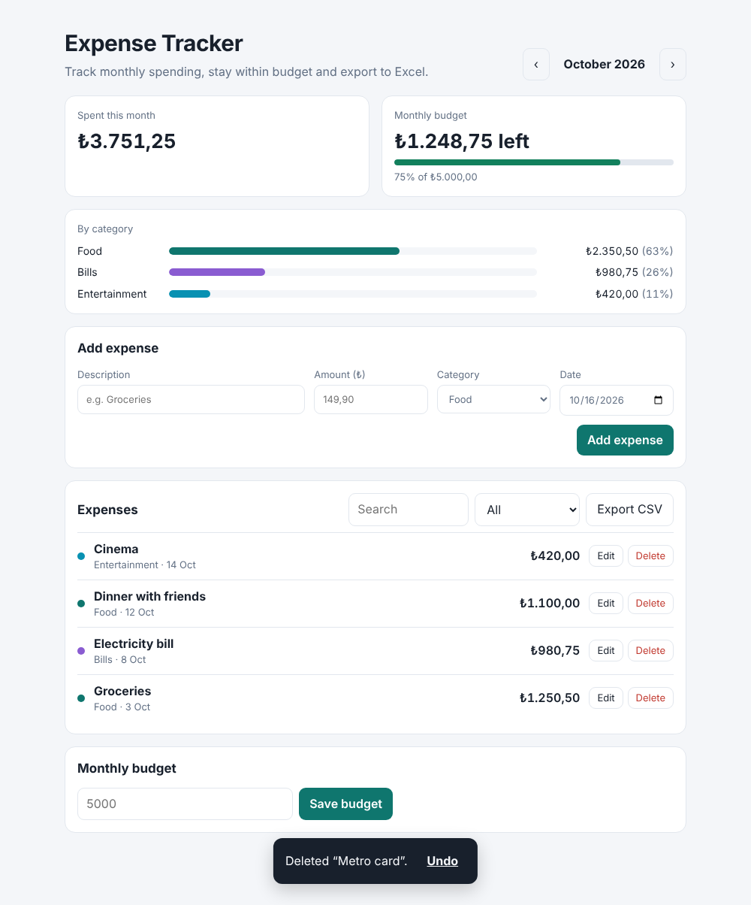

# Expense Tracker

**Live demo:** https://beyza-kilicc.github.io/expense-tracker/

A React + TypeScript app for tracking monthly spending in Turkish lira: add expenses, see where the money goes by category, keep an eye on a monthly budget and export to Excel.



## Features

- Add, edit and delete expenses, with **undo** after a delete
- Month navigation with a comparison to the previous month (▲ / ▼ %)
- Spending by category as a bar chart with shares
- Monthly budget with a progress bar that turns amber at 80% and red when over budget
- Search and category filter
- **CSV export** that opens correctly in Excel (UTF-8 BOM, escaped cells, formula injection blocked)
- Accepts Turkish and English number formats: `1.250,50`, `1,250.50`, `99,90 TL`
- Data is saved in the browser (localStorage) and validated when loaded, so broken data never crashes the app
- Responsive layout, light and dark mode, accessible labels

## Tech stack

| Area | Technologies |
|------|--------------|
| Frontend | React 18, TypeScript, Vite |
| State | `useReducer` for expenses, a custom `useLocalStorage` hook for settings |
| Testing | Vitest (unit tests for parsing, totals, CSV and the reducer) |
| CI | GitHub Actions |

## Running it

```bash
npm install
npm run dev     # http://localhost:5173/expense-tracker/
npm test        # unit tests
npm run build   # type-check and production build
```

## Project structure

```
src/
  lib/expenses.ts         types, amount parsing, validation, totals, CSV, storage checks
  lib/expensesReducer.ts  add / update / remove / restore actions
  hooks/useLocalStorage.ts
  components/             ExpenseForm, ExpenseList, Summary
  App.tsx                 page layout, filters, month navigation, undo
```

## Design decisions

- **Money is stored in kuruş as integers.** `0.1 + 0.2` is not `0.3` in JavaScript, so amounts are kept as whole numbers of kuruş and only formatted as lira for display.
- **Business logic is outside the components.** Parsing, totals and CSV generation are plain functions in `lib/`, which makes them easy to unit test.
- **A reducer for the expense list.** All changes go through four clear actions, which keeps updates predictable and made undo easy to add.
- **Stored data is never trusted.** Everything read from localStorage goes through `sanitizeStored`, so a corrupted or outdated entry is dropped instead of breaking the page.

## Possible next steps

- Recurring expenses (rent, subscriptions)
- Save data to a backend (Spring Boot REST API) instead of the browser
- Component tests with React Testing Library
